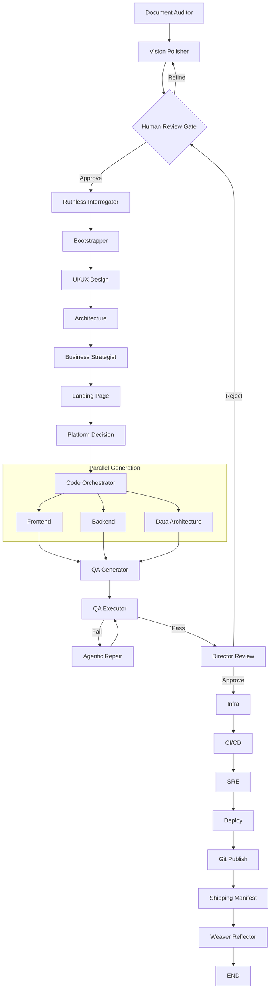
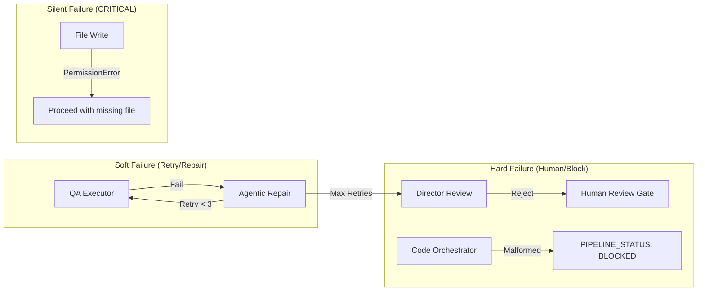

# 01_findings_and_maps

## System Architecture & Data Flow

### Overall System Architecture (LangGraph)


### Data & Control Flow (Happy Path)
1. **Input:** Raw Idea + optional Source Docs.
2. **Contextualization:** RAG and Document Auditing build a "Nucleus" of context.
3. **Specification:** Human-in-the-loop approval of the vision, followed by automated PRD/Architecture/UIUX generation.
4. **Execution:** Template application followed by parallel LLM-driven code generation for UI, Logic, and Platform-specifics.
5. **Validation:** Automated test generation and execution, with a self-healing "Surgeon" loop.
6. **Delivery:** Automated infrastructure, deployment, and git publishing.

### Failure Boundaries


## Detailed Findings Register

### [F01] Category: Reliability | Severity: Critical
- **Location:** `pipeline.py` (Multiple locations: L472, L493, L573, L609, L751, L872, L891, L910, L1019)
- **The Issue:** Silent swallowing of `PermissionError` during critical file operations.
- **The Evidence:**
  ```python
  # pipeline.py L573
  if repo_path:
      try:
          p = sandbox.safe_write("ARCHITECTURE.md", response.content)
          print("   → ARCHITECTURE.md saved")
          _index_files(state["run_id"], gem_name, [p], "spec")
      except PermissionError as e:
          print(f"   ⚠️ SECURITY: {e}")
  ```
- **Failure Scenario:**
  1. The pipeline runs in an environment where the `PROJECTS_ROOT` has restricted permissions.
  2. `ARCHITECTURE.md` fails to write.
  3. The error is printed but not raised, and the state is NOT updated to reflect the failure.
  4. Subsequent agents (Code Orchestrator, Frontend/Backend) try to read `ARCHITECTURE.md`.
  5. The agents receive an empty string or an error message like `[ARCHITECTURE.md not yet available]`.
  6. Generated code is hallucinatory or generic because it lacks the architectural constraints.

### [F02] Category: Architecture | Severity: High
- **Location:** `pipeline.py`
- **The Issue:** Monolithic "God File" orchestration.
- **The Evidence:** `pipeline.py` is ~1100 lines long and contains all 24 node definitions, LangGraph routing logic, caching logic, and worker proxying.
- **Failure Scenario:** 
  1. A developer wants to add a new "Security Auditor" agent.
  2. They must modify the massive `_build_pipeline` function and add a new node in the same file.
  3. A merge conflict occurs with another developer fixing a bug in the `deploy_node`.
  4. The complexity of the file makes it prone to regression during these manual merges.

### [F03] Category: Cognitive Load | Severity: High
- **Location:** `state.py` and `pipeline.py`
- **The Issue:** Unstructured Global State Mutation.
- **The Evidence:** `PipelineState` is a large `TypedDict` passed by reference. While LangGraph uses immutable state updates, the "functional update" pattern in `logged_node` is manually merging metrics into the state.
- **Failure Scenario:**
  1. Two parallel nodes (e.g., `frontend` and `backend`) attempt to update a shared, non-annotated field in the future.
  2. One update silently overwrites the other due to the way LangGraph merges results from parallel branches. (Currently, the nodes seem isolated, but the pattern is brittle).

### [F04] Category: AI-Native DX | Severity: Med
- **Location:** `core/repair/agentic_loop.py`
- **The Issue:** Identical Patch Stalling.
- **The Evidence:**
  ```python
  # core/repair/agentic_loop.py L100
  if any(h.get("patch_hash") == patch_hash for h in history):
      logger.warning(f"Repair novelty check failed for run {run_id}: identical patch proposed.", extra={"run_id": run_id})
      return {
          "tests_passed": False,
          "repair_status": "stalled_identical_patch",
          "progress_log": ["❌ Agentic Repair stalled: Surgeon proposed identical patch"]
      }
  ```
- **Failure Scenario:** 
  1. A small syntax error in a test file is misdiagnosed by the Surgeon.
  2. The Surgeon proposes a fix that doesn't actually solve the root cause.
  3. In attempt 2, the Surgeon proposes the same fix because the `retrieved_context` and `failure_report` haven't changed enough to shift the LLM's "opinion".
  4. The pipeline stalls even though a different prompt or more context might have solved it.

### [F05] Category: Security | Severity: Low
- **Location:** `dashboard.py`
- **The Issue:** Lack of exposure protection for sensitive cost data.
- **The Evidence:** The dashboard displays all-time total costs and session-specific token usage without any authentication gate.
- **Failure Scenario:** 
  1. A developer runs `streamlit run dashboard.py` on a shared server or with an exposed port.
  2. An attacker views the dashboard and gains insights into the volume of usage, project names, and internal cost structures.
