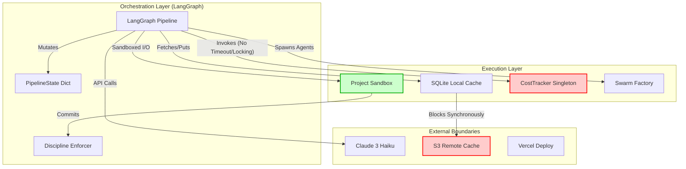
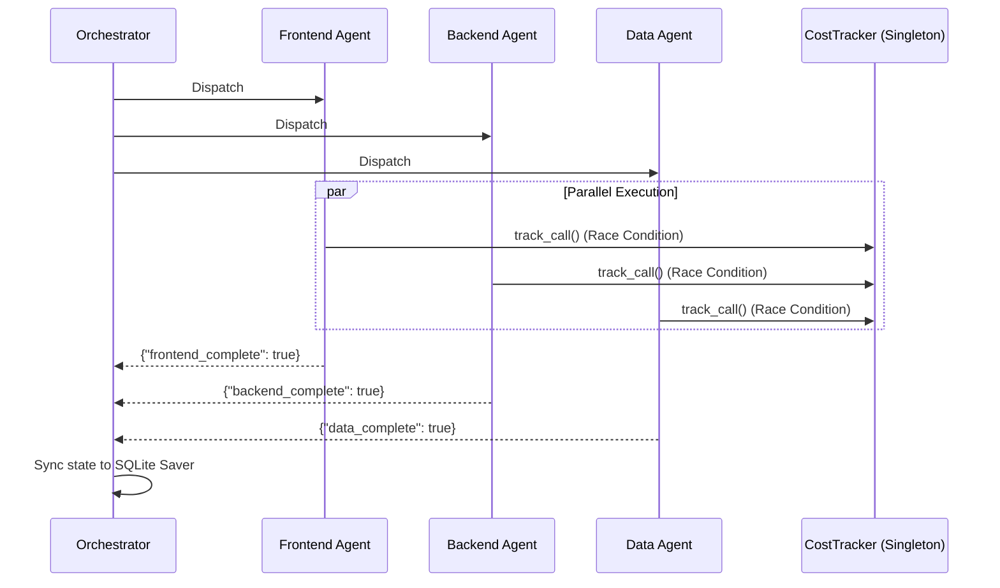

# GemForge Comprehensive System & Codebase Audit 

### 1. Executive Summary & Blast Radius
**Overall Grade:** B- 
**The "Elevator Pitch" of Repo Health:** GemForge presents a visionary, multi-agent LangGraph architecture equipped with strong concepts like deterministic build caching, rigorous discipline enforcement, and sandboxed file writing. However, the implementation is heavily constrained by critical thread-safety bugs in core singletons, severe blocking behaviors in its remote caching layer, and highly brittle test/build integrations that threaten long-term operability and reliability.
**Top 5 Critical Risks:**
1. **Thread-Safety & State Corruption:** Parallel agents (`frontend`, `backend`, `data`) mutate the `cost_tracker` singleton without locking, causing lost updates to billing/token metrics. 
2. **Synchronous S3 Poisoning:** `RemoteCacheProvider` uses synchronous `boto3` calls with infinite timeouts inside the node execution path. A network partition will permanently hang the orchestration graph.
3. **Hardcoded Test/Build Environments:** The `executor_tools` layer hardcodes destinations like `platform=iOS Simulator,name=iPhone 16` and assumes `npm` or `xcodegen` are globally available, blocking deployments entirely if the environment drifts.
4. **Autonomous Host Mutations (Blast Radius):** `install_xcodegen` arbitrarily executes `brew install xcodegen`, mutating the host machine without consent, posing significant security and operational risks in CI environments.
5. **Dangling File Handles & Injection:** `SwarmFactory` dynamically writes temporary prompt files based on agent missions without ever cleaning them up, creating a slow disk leak.

**Immediate Action Plan:**
- **24hr:** Add `threading.Lock` to `cost_tracker.py` to prevent billing data loss, and wrap `boto3` S3 calls in strict `botocore.config.Config` timeouts.
- **1-week:** Remove all host-mutating `brew` commands and parameterize test runner targets (e.g., dynamically query available simulators using `xcrun simctl`).
- **1-month:** Migrate `cost_tracker` entirely into the functional `PipelineState` using `operator.add` reducers to eliminate the singleton pattern entirely and adhere strictly to LangGraph's functional paradigm.

---

### 2. Architectural & Flow Diagrams

**System Architecture & Failure Boundaries**


**Parallel Data/Control Flow (Happy Path)**


---

### 3. Detailed Findings Register

**[FINDING-01] Thread-Safety Violations in Cost Tracking | Severity: Critical**
- **Location:** `tools/cost_tracker.py` (`CostTracker.track_call`) & `pipeline.py` (parallel node fan-out)
- **The Issue:** The `frontend`, `backend`, and `data` nodes execute concurrently via LangGraph. They all invoke `cost_aware_invoke`, which calls `cost_tracker.track_call(response)`. The `CostTracker` is a global singleton, and in Python, `self.total_tokens += ...` is not atomic.
- **The Evidence:** 
  ```python
  # tools/cost_tracker.py
  def track_call(self, response) -> dict:
      ...
      self.total_tokens += input_t + output_t
      self.total_cost += cost
  ```
- **Failure Scenario:** Three parallel agents return from Claude simultaneously. They all read `self.total_tokens` as `1000`. They each add `500` to it. The final value becomes `1500` instead of `2500`. The user underpays for the execution, and usage limits fail to trigger.
- **Actionable Fix:** Introduce a `threading.Lock()` inside `CostTracker` to synchronize updates.

**[FINDING-02] Unbounded Synchronous Remote Cache Blocking | Severity: High**
- **Location:** `core/build/cache.py` (`RemoteCacheProvider.get` & `.set`)
- **The Issue:** The remote cache attempts to use `boto3.client('s3')` synchronously inside the execution path without specifying network timeouts.
- **The Evidence:**
  ```python
  # core/build/cache.py
  elif self.backend == "s3":
      try:
          import boto3
          s3 = boto3.client('s3') # No Config(connect_timeout=X)
          response = s3.get_object(Bucket=self.bucket, Key=f"cache/{key}.json")
  ```
- **Failure Scenario:** A transient network partition occurs, or AWS S3 routes traffic poorly. The `get_object` call hangs indefinitely because the default TCP timeout in `urllib3/boto3` is 60 seconds (or unbounded depending on OS TCP settings). The pipeline node never completes, wasting compute and hanging the CLI.
- **Actionable Fix:** Use `botocore.client.Config(connect_timeout=2, read_timeout=3)` to force a fast failover to the local SQLite cache.

**[FINDING-03] Autonomous Host Mutation | Severity: High**
- **Location:** `tools/project_tools.py` (`install_xcodegen`)
- **The Issue:** The framework attempts to act as a system administrator by running package managers on the host machine without consent.
- **The Evidence:**
  ```python
  # tools/project_tools.py
  print("   Installing xcodegen via Homebrew...")
  r = subprocess.run(["brew", "install", "xcodegen"], capture_output=True, text=True)
  ```
- **Failure Scenario:** A developer runs GemForge in a restricted CI environment or on a system where Homebrew is managed differently. The `brew install` command fails, or worse, triggers an unintended system-wide update of dependencies that breaks other tools. 
- **Actionable Fix:** Remove this function. Use `CommandFailure` to halt and instruct the user: *"xcodegen is required. Please install it using `brew install xcodegen` and restart."*

**[FINDING-04] Hardcoded Environmental Bindings | Severity: High**
- **Location:** `tools/executor_tools.py` (`run_tests` & `build_and_verify_xcode`)
- **The Issue:** iOS simulator environments are hardcoded to a specific device string that may not exist on the host machine.
- **The Evidence:**
  ```python
  # tools/executor_tools.py
  "-destination", "platform=iOS Simulator,name=iPhone 16",
  ```
- **Failure Scenario:** A user runs the iOS pipeline on Xcode 15, which only supports up to `iPhone 15`. The tests immediately fail, which cascades into the `director_node` rejecting the build indefinitely because QA is a hard gate.
- **Actionable Fix:** Fall back to a dynamic destination or the default scheme target if a specific device name fails, or utilize `xcrun simctl list devices` to grab the first available booted simulator.

---

### 4. Codebase Maturity Matrix

- **Domain Logic Isolation: 4/5**
  - *The LangGraph graph cleanly orchestrates flow, and `ProjectSandbox` successfully prevents agents from arbitrary I/O via `relative_to` checks.*
- **Error Handling & State Recovery: 3/5**
  - *Good discipline enforcement (`DisciplineEnforcer`), but fails to catch and isolate pipeline hangs caused by 3rd party IO (e.g. S3 caching, LLM looping).*
- **Cognitive Load: 4/5**
  - *Excellent use of single-responsibility agents and clear state representation. A new developer can easily trace execution in `pipeline.py`.*
- **Observability: 2/5**
  - *While it prints logs cleanly, the lack of structured logging (e.g., JSON logs) outside of the `audit.log` makes it difficult to debug hangs or parse metrics automatically.*
- **AI-Native DX: 5/5**
  - *Exceptional. The explicit `TypedDict` for state, highly modular prompt templates, and isolated functions make it incredibly easy for an LLM to hold context and propose isolated fixes.*
- **Test Fidelity: 1/5**
  - *Tests rely completely on the host system state (`npm`, `xcodebuild`, specific simulators) meaning CI pipelines are inherently brittle and flaky.*
