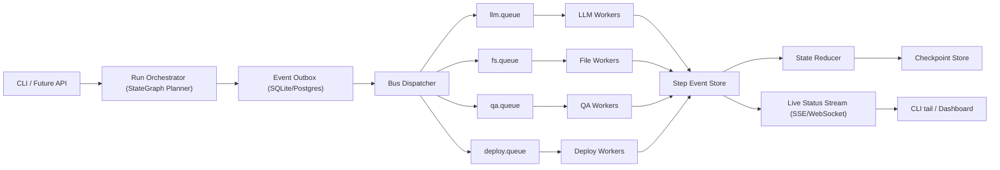

# Blueprint 01: Event-Driven Forge Runtime

## 1. Executive Summary
GemForge currently executes as a single synchronous LangGraph invocation with a checkpointed pause model. This works for one run at a time, but it bottlenecks throughput, hides per-step latency, and makes retries coarse (whole-graph resume instead of targeted step replay). The architecture upgrade is to move step execution to a durable event-driven runtime while keeping existing node logic and prompts.

The key shift is from "graph as a blocking function call" to "graph as a state transition planner emitting durable work events." Each node becomes a typed job handled by worker pools (`llm`, `filesystem`, `qa`, `deploy`, `git`). This enables horizontal parallelism, precise retry semantics, real-time progress streams, and better cost/time controls.

This is a strangler migration. We keep `pipeline.py` and existing node bodies, then introduce an event bus abstraction and route selected nodes through workers behind feature flags. No stop-the-world rewrite is required.

## 2. Outcomes
1. 5-10x higher concurrent run capacity.
2. Step-level retries and dead-letter handling instead of whole-run failure.
3. Real-time run telemetry (queued/running/succeeded/failed per step).
4. Lower median time-to-first-artifact via prioritized worker queues.

## 3. Current State Constraints
1. `get_pipeline_app().invoke(...)` executes all active work in-process.
2. External calls (LLM, subprocess, deploy) block the main orchestrator path.
3. Failure handling is mostly exception-driven and local to call stack.
4. Observability is coarse (`progress_log`, stdout, cost totals).
5. Parallelism exists only in one fan-out section and still shares one process.

## 4. Target Architecture


## 5. Core Contracts
### 5.1 Event Envelope
```json
{
  "event_id": "uuid",
  "run_id": "gem-idea-20260225",
  "step_id": "architecture",
  "attempt": 1,
  "event_type": "step.requested",
  "priority": 5,
  "payload": {
    "state_slice": {},
    "artifact_refs": []
  },
  "created_at": "2026-02-25T10:00:00Z"
}
```

### 5.2 Step Handler Contract
```python
from dataclasses import dataclass
from typing import Protocol

@dataclass
class StepRequest:
    run_id: str
    step_id: str
    attempt: int
    payload: dict

@dataclass
class StepResult:
    status: str  # succeeded | failed | retryable_failed
    state_patch: dict
    artifacts: list[str]
    metrics: dict
    error: str | None = None

class StepHandler(Protocol):
    def handle(self, req: StepRequest) -> StepResult: ...
```

## 6. Storage Model (Phase 1: SQLite, Phase 2: Postgres)
```sql
CREATE TABLE IF NOT EXISTS pipeline_runs (
  run_id TEXT PRIMARY KEY,
  thread_id TEXT NOT NULL,
  status TEXT NOT NULL,
  started_at TEXT NOT NULL,
  updated_at TEXT NOT NULL,
  current_state_json TEXT NOT NULL
);

CREATE TABLE IF NOT EXISTS run_steps (
  run_id TEXT NOT NULL,
  step_id TEXT NOT NULL,
  status TEXT NOT NULL,
  attempt INTEGER NOT NULL DEFAULT 0,
  started_at TEXT,
  finished_at TEXT,
  last_error TEXT,
  PRIMARY KEY (run_id, step_id)
);

CREATE TABLE IF NOT EXISTS step_events (
  event_id TEXT PRIMARY KEY,
  run_id TEXT NOT NULL,
  step_id TEXT NOT NULL,
  attempt INTEGER NOT NULL,
  event_type TEXT NOT NULL,
  payload_json TEXT NOT NULL,
  created_at TEXT NOT NULL
);

CREATE TABLE IF NOT EXISTS event_outbox (
  id INTEGER PRIMARY KEY AUTOINCREMENT,
  event_json TEXT NOT NULL,
  published INTEGER NOT NULL DEFAULT 0,
  created_at TEXT NOT NULL
);
```

## 7. Implementation Plan (Incremental)
### Phase 0: Instrument Existing Runtime
1. Add structured step lifecycle events in `pipeline.py` before/after each node.
2. Persist events to `step_events`.
3. Add a CLI tail command (`gemforge runs tail <run_id>`) reading event stream.

### Phase 1: Introduce Event Bus Abstraction
1. Create `core/runtime/event_bus.py` with `publish` and `subscribe`.
2. Implement `SQLiteOutboxBus` that writes to `event_outbox`.
3. Add background dispatcher process (`tools/runtime_dispatcher.py`) that forwards outbox rows to queues.

### Phase 2: Workerized Steps
1. Move high-latency nodes first: `vision_polisher`, `ruthless_interrogator`, `qa`, `deploy`.
2. Keep state reduction centralized; workers return patches only.
3. Add retry policy by step type (`llm`: exponential backoff, `deploy`: capped retries).

### Phase 3: Prioritized Queues + Live Status API
1. Create priority tiers (`urgent`, `normal`, `bulk`) per queue.
2. Add status API endpoint for dashboard streaming.
3. Emit latency/cost/error metrics per step.

### Phase 4: Full Orchestrator Decoupling
1. Planner emits only events and dependency edges.
2. Step completion events trigger downstream scheduling.
3. Keep `StateGraph` for dependency definition, not direct execution.

## 8. File-Level Changes
1. New: `core/runtime/event_bus.py`
2. New: `core/runtime/outbox_store.py`
3. New: `core/runtime/worker.py`
4. New: `core/runtime/reducer.py`
5. Update: `pipeline.py` (emit step events, route to async handlers when enabled)
6. Update: `src/gemforge/cli.py` (run status/tail commands)
7. New: `tests/test_runtime_event_bus.py`

## 9. Reference Boilerplate
```python
# core/runtime/event_bus.py
import json
import sqlite3
from dataclasses import asdict
from datetime import datetime, timezone

class SQLiteOutboxBus:
    def __init__(self, db_path: str):
        self.conn = sqlite3.connect(db_path, check_same_thread=False)
        self.conn.execute(
            "CREATE TABLE IF NOT EXISTS event_outbox ("
            "id INTEGER PRIMARY KEY AUTOINCREMENT, "
            "event_json TEXT NOT NULL, "
            "published INTEGER NOT NULL DEFAULT 0, "
            "created_at TEXT NOT NULL)"
        )
        self.conn.commit()

    def publish(self, event: dict) -> None:
        self.conn.execute(
            "INSERT INTO event_outbox (event_json, published, created_at) VALUES (?, 0, ?)",
            (json.dumps(event), datetime.now(timezone.utc).isoformat()),
        )
        self.conn.commit()
```

```python
# core/runtime/worker.py
class Worker:
    def __init__(self, step_registry: dict[str, callable]):
        self.step_registry = step_registry

    def run_once(self, request: dict) -> dict:
        step_id = request["step_id"]
        handler = self.step_registry[step_id]
        try:
            result = handler(request)
            return {"status": "succeeded", "result": result}
        except Exception as exc:
            return {"status": "retryable_failed", "error": str(exc)}
```

## 10. Feature Flags
1. `GEMFORGE_RUNTIME_MODE=sync|hybrid|evented`
2. `GEMFORGE_WORKER_ENABLED_STEPS=vision_polisher,qa,deploy`
3. `GEMFORGE_ENABLE_LIVE_STATUS=true|false`

## 11. Testing and Gates
1. Unit: event serialization, outbox durability, reducer idempotency.
2. Integration: one run through hybrid mode with workerized `vision_polisher`.
3. Failure injection: force LLM 429; verify retry + event timeline.
4. Regression: generated artifacts must match sync-mode output for same seed input.

## 12. Risks and Mitigations
1. Event duplication.
   Mitigation: idempotent reducer keyed by `(run_id, step_id, attempt, event_type)`.
2. Out-of-order completion.
   Mitigation: dependency checks before accepting state patches.
3. Operational overhead.
   Mitigation: start with SQLite outbox + local worker process, then external queue.

## 13. Success Criteria
1. P95 run duration reduced by >=35% under 10 concurrent runs.
2. Step retry recovery rate >=90% for transient failures.
3. Zero data loss for accepted events during process restarts.
4. Real-time status visibility for every step transition.
