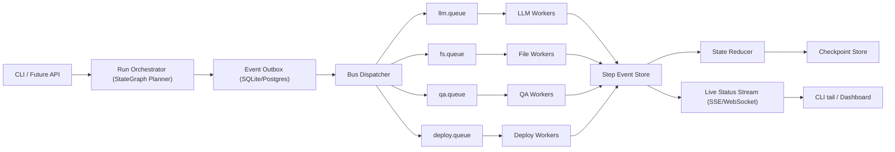

# Blueprint 01: Event-Driven Forge Runtime

## 1. Executive Summary
This blueprint takes `PipelineState` step requests from [`pipeline.py`](../../pipeline.py), routes each step through a durable SQLite outbox and typed worker queues with step-level retry policies, and outputs persisted step events, reduced checkpoint state, and live status streams.

GemForge originally ran every stage inside one synchronous LangGraph `invoke(...)` call. Running everything in one process limits concurrency, hides per-step latency, and forces coarse whole-graph retries instead of targeted step replay.

Moving step execution to an event-driven runtime turns the graph into a state-transition planner that emits typed jobs to worker pools (`llm`, `filesystem`, `qa`, `deploy`, `git`). Keeping [`pipeline.py`](../../pipeline.py) and existing node handlers behind feature flags lets operators migrate stages incrementally without a stop-the-world rewrite.

## 2. Outcomes
1. 5-10x higher concurrent run capacity.
2. Step-level retries and dead-letter handling instead of whole-run failure.
3. Real-time run telemetry (`queued`, `running`, `succeeded`, `failed` per step).
4. Lower median time-to-first-artifact through prioritized worker queues.

## 3. Current State Constraints
1. `get_pipeline_app().invoke(...)` executes active work in one process when worker mode is off.
2. External calls (LLM requests, test subprocesses, deployments) block the main orchestrator thread.
3. Failure handling without an event log stays local to the active call stack.
4. Coarse stdout logging obscures per-step queue and execution durations.
5. Single-process fan-out shares CPU and memory across parallel code generators.

## 4. Target Architecture


## 5. Core Contracts
### 5.1 Event Envelope
```json
{
  "event_id": "uuid",
  "run_id": "gem-idea-20260225",
  "step_id": "architecture",
  "attempt": 1,
  "event_type": "step.requested",
  "priority": 5,
  "payload": {
    "state_slice": {},
    "artifact_refs": []
  },
  "created_at": "2026-02-25T10:00:00Z"
}
```

### 5.2 Step Handler Contract
```python
from dataclasses import dataclass
from typing import Protocol

@dataclass
class StepRequest:
    run_id: str
    step_id: str
    attempt: int
    payload: dict

@dataclass
class StepResult:
    status: str  # succeeded | failed | retryable_failed
    state_patch: dict
    artifacts: list[str]
    metrics: dict
    error: str | None = None

class StepHandler(Protocol):
    def handle(self, req: StepRequest) -> StepResult: ...
```

## 6. Storage Model (Phase 1: SQLite, Phase 2: Postgres)
```sql
CREATE TABLE IF NOT EXISTS pipeline_runs (
  run_id TEXT PRIMARY KEY,
  thread_id TEXT NOT NULL,
  status TEXT NOT NULL,
  started_at TEXT NOT NULL,
  updated_at TEXT NOT NULL,
  current_state_json TEXT NOT NULL
);

CREATE TABLE IF NOT EXISTS run_steps (
  run_id TEXT NOT NULL,
  step_id TEXT NOT NULL,
  status TEXT NOT NULL,
  attempt INTEGER NOT NULL DEFAULT 0,
  started_at TEXT,
  finished_at TEXT,
  last_error TEXT,
  PRIMARY KEY (run_id, step_id)
);

CREATE TABLE IF NOT EXISTS step_events (
  event_id TEXT PRIMARY KEY,
  run_id TEXT NOT NULL,
  step_id TEXT NOT NULL,
  attempt INTEGER NOT NULL,
  event_type TEXT NOT NULL,
  payload_json TEXT NOT NULL,
  created_at TEXT NOT NULL
);

CREATE TABLE IF NOT EXISTS event_outbox (
  id INTEGER PRIMARY KEY AUTOINCREMENT,
  event_json TEXT NOT NULL,
  published INTEGER NOT NULL DEFAULT 0,
  created_at TEXT NOT NULL
);
```

## 7. Implementation Plan (Incremental)
### Phase 0: Instrument Existing Runtime
1. Emit structured step lifecycle events in [`pipeline.py`](../../pipeline.py) before and after each node.
2. Persist events to `step_events`.
3. Provide `gemforge runs tail <run_id>` in [`src/gemforge/cli.py`](../../src/gemforge/cli.py) to read the event stream.

### Phase 1: Introduce Event Bus Abstraction
1. Implement [`core/runtime/event_bus.py`](../../core/runtime/event_bus.py) with `publish` and `subscribe`.
2. Persist queued messages via [`core/runtime/outbox_store.py`](../../core/runtime/outbox_store.py).
3. Run a background dispatcher ([`tools/runtime_dispatcher.py`](../../tools/runtime_dispatcher.py)) that forwards outbox rows to worker queues.

### Phase 2: Workerized Steps
1. Offload high-latency nodes first: `vision_polisher`, `ruthless_interrogator`, `qa`, and `deploy`.
2. Keep state reduction centralized in [`core/runtime/reducer.py`](../../core/runtime/reducer.py) so workers return state patches only.
3. Enforce retry policies by step type (`llm`: exponential backoff; `deploy`: capped retries).

### Phase 3: Prioritized Queues and Live Status API
1. Define priority tiers (`urgent`, `normal`, `bulk`) per queue.
2. Expose a status API in [`core/runtime/api.py`](../../core/runtime/api.py) for Server-Sent Events (SSE) or WebSocket dashboard streaming.
3. Emit latency, token cost, and error counters per step.

### Phase 4: Full Orchestrator Decoupling
1. Emit only events and dependency edges from the planner.
2. Trigger downstream step scheduling from step completion events.
3. Retain `StateGraph` for dependency declarations rather than blocking in-process execution.

## 8. File-Level Modules
1. [`core/runtime/event_bus.py`](../../core/runtime/event_bus.py)
2. [`core/runtime/outbox_store.py`](../../core/runtime/outbox_store.py)
3. [`core/runtime/worker/`](../../core/runtime/worker/__init__.py)
4. [`core/runtime/reducer.py`](../../core/runtime/reducer.py)
5. [`pipeline.py`](../../pipeline.py)
6. [`src/gemforge/cli.py`](../../src/gemforge/cli.py)
7. [`tests/test_blueprint_01_runtime.py`](../../tests/test_blueprint_01_runtime.py)

## 9. Reference Boilerplate
```python
# core/runtime/event_bus.py
import json
import sqlite3
from datetime import datetime, timezone

class SQLiteOutboxBus:
    def __init__(self, db_path: str):
        self.conn = sqlite3.connect(db_path, check_same_thread=False)
        self.conn.execute(
            "CREATE TABLE IF NOT EXISTS event_outbox ("
            "id INTEGER PRIMARY KEY AUTOINCREMENT, "
            "event_json TEXT NOT NULL, "
            "published INTEGER NOT NULL DEFAULT 0, "
            "created_at TEXT NOT NULL)"
        )
        self.conn.commit()

    def publish(self, event: dict) -> None:
        self.conn.execute(
            "INSERT INTO event_outbox (event_json, published, created_at) VALUES (?, 0, ?)",
            (json.dumps(event), datetime.now(timezone.utc).isoformat()),
        )
        self.conn.commit()
```

```python
# core/runtime/worker.py
class Worker:
    def __init__(self, step_registry: dict[str, callable]):
        self.step_registry = step_registry

    def run_once(self, request: dict) -> dict:
        step_id = request["step_id"]
        handler = self.step_registry[step_id]
        try:
            result = handler(request)
            return {"status": "succeeded", "result": result}
        except Exception as exc:
            return {"status": "retryable_failed", "error": str(exc)}
```

## 10. Feature Flags
1. `GEMFORGE_RUNTIME_MODE=sync|hybrid|evented`
2. `GEMFORGE_WORKER_ENABLED_STEPS=vision_polisher,qa,deploy`
3. `GEMFORGE_ENABLE_LIVE_STATUS=true|false`

## 11. Testing and Gates
1. Unit: event serialization, outbox durability, and reducer idempotency.
2. Integration: hybrid-mode execution with workerized steps.
3. Failure injection: simulated rate-limit (`429`) error verifying retry backoff and event timeline.
4. Regression: generated project files match synchronous-mode output for identical seed inputs.

## 12. Risks and Mitigations
1. Event duplication.
   Mitigation: idempotent reducer keyed by `(run_id, step_id, attempt, event_type)`.
2. Out-of-order completion.
   Mitigation: dependency checks before applying state patches.
3. Operational overhead.
   Mitigation: start with SQLite outbox and local worker processes before enabling Redis queues.

## 13. Success Criteria
1. 95th-percentile run duration reduced by at least 35% across 10 concurrent runs.
2. Step retry recovery rate of at least 90% on transient failures.
3. Zero lost accepted events across process restarts.
4. Live status visibility for every step transition.
