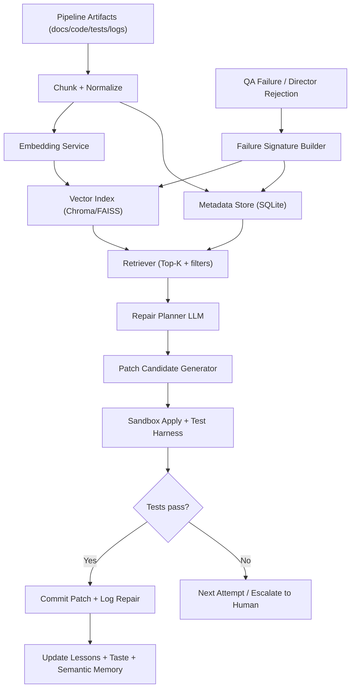

# Blueprint 02: Semantic Memory + Agentic Repair Loop

## 1. Executive Summary
GemForge stores lessons and user taste, but it does not currently retrieve past technical outcomes to improve new generations or auto-repair failing runs. This blueprint introduces a semantic memory plane plus a controlled agentic repair loop that can diagnose failures, propose patches, verify via tests, and merge successful fixes.

The strategic value is compounding quality. Every failure and fix becomes reusable knowledge for subsequent runs, reducing repeated defects and manual intervention. Combined with current `qa_node` and `director_node`, this turns the pipeline from "generate then fail fast" into "generate, adapt, and harden."

Implementation remains incremental: first add retrieval-augmented context for generation, then add one bounded repair attempt, then evolve to multi-attempt self-healing with strict safety budgets.

## 2. Outcomes
1. Higher first-pass test success through retrieval-grounded generation.
2. Autonomous correction for common compile/test failures.
3. Durable memory of failure signatures, patches, and verification outcomes.
4. Continuous quality lift without changing core prompt inventory every run.

## 3. Target Architecture


## 4. Memory Model
### 4.1 Document Types to Index
1. Generated source files (`.py`, `.ts`, `.tsx`, `.swift`, `.kt`, `.dart`).
2. Specs and architecture docs.
3. QA/test outputs and failure traces.
4. Director feedback and human refinement prompts.
5. Accepted repair patches and post-repair reports.

### 4.2 SQL Schema (Metadata and Repair Ledger)
```sql
CREATE TABLE IF NOT EXISTS semantic_docs (
  doc_id TEXT PRIMARY KEY,
  run_id TEXT NOT NULL,
  project_name TEXT NOT NULL,
  path TEXT NOT NULL,
  doc_type TEXT NOT NULL,
  content_hash TEXT NOT NULL,
  chunk_count INTEGER NOT NULL,
  created_at TEXT NOT NULL
);

CREATE TABLE IF NOT EXISTS semantic_chunks (
  chunk_id TEXT PRIMARY KEY,
  doc_id TEXT NOT NULL,
  run_id TEXT NOT NULL,
  chunk_index INTEGER NOT NULL,
  text_excerpt TEXT NOT NULL,
  token_count INTEGER NOT NULL,
  vector_ref TEXT NOT NULL,
  created_at TEXT NOT NULL
);

CREATE TABLE IF NOT EXISTS repair_attempts (
  attempt_id TEXT PRIMARY KEY,
  run_id TEXT NOT NULL,
  failure_signature TEXT NOT NULL,
  attempt_number INTEGER NOT NULL,
  strategy TEXT NOT NULL,
  candidate_patch_summary TEXT NOT NULL,
  status TEXT NOT NULL,
  tests_report TEXT,
  created_at TEXT NOT NULL
);
```

## 5. Core Loop Design
### 5.1 Failure Signature
Normalize errors into stable signatures:
1. Runtime/tool context (`xcodebuild`, `npm test`, `pytest`).
2. Primary error type (compile, import, type mismatch, missing file).
3. Top stack lines and failing file paths.
4. Platform and template metadata.

Example:
```text
platform=nextjs|runner=jest|error=module-not-found|missing=app/components/Foo.tsx
```

### 5.2 Repair Loop Policy
1. Max attempts per run: `3`.
2. Max changed files per attempt: `8`.
3. Max token budget per attempt: configurable.
4. Allowed write scope: only under project root; no secret/env file edits.
5. Mandatory verification: tests must pass before acceptance.

### 5.3 Decision Tree
1. If retrieval confidence is high and known fix exists, apply deterministic patch template.
2. Else invoke planner LLM with retrieved context and failure signature.
3. If attempt fails twice with low novelty, escalate to human review with summary.

## 6. Implementation Plan (Incremental)
### Phase 0: Retrieval for Generation Context
1. Add semantic indexer for newly generated artifacts after `code_orchestrator`.
2. Retrieve relevant prior artifacts for `frontend`, `backend`, `data` prompts.
3. Track impact on first-pass QA results.

### Phase 1: Single-Attempt Auto-Repair
1. On `qa_node` failure, invoke `repair_node` once.
2. Generate patch, apply changes, rerun tests.
3. Save attempt metadata in `repair_attempts`.

### Phase 2: Multi-Attempt Controlled Loop
1. Add bounded retry loop with strategy switching.
2. Add novelty threshold to avoid repeated near-identical patches.
3. Emit rich artifacts: `REPAIR_REPORT.md`, `PATCH_EXPLAIN.md`.

### Phase 3: Cross-Run Learning
1. Promote successful repair patterns to prompt snippets.
2. Auto-tag frequent failure families and preemptively adjust generation.
3. Feed summarized outcomes into Weaver and taste memory.

## 7. File-Level Changes
1. New: `core/memory/semantic_index.py`
2. New: `core/memory/retriever.py`
3. New: `core/repair/signature.py`
4. New: `core/repair/agentic_loop.py`
5. Update: `pipeline.py` (insert `repair_node` after QA failure path)
6. Update: `core/evolution/weaver.py` (ingest repair outcomes)
7. New: `tests/test_failure_signature.py`
8. New: `tests/test_agentic_repair_loop.py`

## 8. Reference Boilerplate
```python
# core/repair/signature.py
import re

def build_failure_signature(platform: str, runner: str, raw_output: str) -> str:
    normalized = raw_output.lower()
    if "module not found" in normalized:
        kind = "module-not-found"
    elif "typeerror" in normalized or "type error" in normalized:
        kind = "type-error"
    elif "cannot find name" in normalized:
        kind = "symbol-not-found"
    else:
        kind = "unknown"

    path_match = re.search(r"([A-Za-z0-9_./-]+\.(ts|tsx|py|swift|kt|dart))", raw_output)
    path = path_match.group(1) if path_match else "n/a"
    return f"platform={platform}|runner={runner}|error={kind}|path={path}"
```

```python
# core/repair/agentic_loop.py
def run_agentic_repair(context: dict, max_attempts: int = 3) -> dict:
    for attempt in range(1, max_attempts + 1):
        retrieved = context["retriever"].search(context["failure_signature"], k=8)
        plan = context["planner"].plan(context["failure"], retrieved, attempt=attempt)
        patch = context["generator"].generate_patch(plan)
        context["applier"].apply(patch)
        result = context["tester"].run()
        if result["success"]:
            return {"status": "repaired", "attempts": attempt, "report": result["report"]}
    return {"status": "escalate", "attempts": max_attempts}
```

## 9. Dependency Additions
```toml
# pyproject.toml
dependencies = [
  # existing...
  "chromadb>=0.5.0",
  "sentence-transformers>=3.0.0",
  "numpy>=2.0.0"
]
```

## 10. Feature Flags
1. `GEMFORGE_SEMANTIC_MEMORY_ENABLED=true|false`
2. `GEMFORGE_AUTO_REPAIR_ENABLED=true|false`
3. `GEMFORGE_AUTO_REPAIR_MAX_ATTEMPTS=1..3`
4. `GEMFORGE_AUTO_REPAIR_WRITE_CAP=8`

## 11. Testing and Validation
1. Unit: signature extraction from representative test logs.
2. Unit: retriever precision for known failure categories.
3. Integration: induced Next.js failure repaired in <=2 attempts.
4. Safety: verify blocked writes outside project root.
5. Regression: ensure no repair runs when QA already passed.

## 12. Risk Register
1. Hallucinated patches that degrade code quality.
   Mitigation: strict test gate plus max file-change cap.
2. Retrieval drift from noisy documents.
   Mitigation: indexed doc-type filters and recency weighting.
3. Cost blowout from repeated repair loops.
   Mitigation: per-attempt token budget and hard max attempts.

## 13. Success Criteria
1. >=25% reduction in manual intervention after QA failures.
2. >=20% increase in first-pass or auto-repaired pass rates.
3. >=70% of successful repairs reusable via future retrieval hits.
4. No unauthorized file modifications in safety tests.
