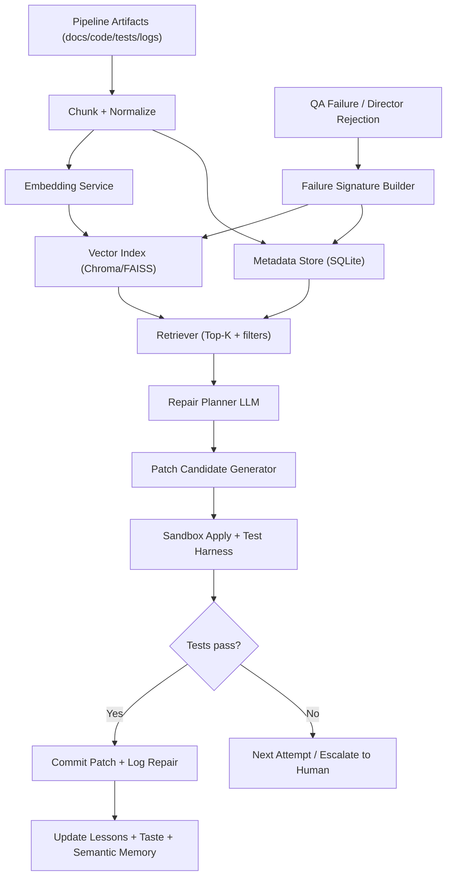

# Blueprint 02: Semantic Memory and Agentic Repair Loop

## 1. Executive Summary
This blueprint takes generated source files, test failure logs, and prior repair records as inputs, extracts normalized failure signatures to retrieve relevant fixes and test candidate patches inside a bounded loop, and outputs verified code fixes plus indexed semantic memory entries.

Storing static text lessons alone does not retrieve past compile or test fixes during active code generation. Combining vector retrieval with a bounded repair loop lets `qa_node` and `director_node` diagnose recurring build failures, verify candidate patches against the project test suite, and reuse proven repairs on future runs.

Rollout proceeds in three stages: retrieve prior artifacts during code generation, run a single bounded repair attempt on test failure, and expand to multi-attempt repair under strict file-count and token caps.

## 2. Outcomes
1. Higher first-pass test pass rates through retrieval-grounded code generation.
2. Automated repair for common compile, import, and test failures.
3. Durable records of failure signatures, patches, and test verification results.
4. Reusable fix context without rewriting base agent prompt files after every run.

## 3. Target Architecture


## 4. Memory Model
### 4.1 Document Types to Index
1. Generated source files (`.py`, `.ts`, `.tsx`, `.swift`, `.kt`, `.dart`).
2. Product specifications and architecture documents.
3. Test runner outputs and stack traces.
4. Director review notes and operator refinement feedback.
5. Verified repair patches and post-repair summaries.

### 4.2 SQL Schema (Metadata and Repair Ledger)
```sql
CREATE TABLE IF NOT EXISTS semantic_docs (
  doc_id TEXT PRIMARY KEY,
  run_id TEXT NOT NULL,
  project_name TEXT NOT NULL,
  path TEXT NOT NULL,
  doc_type TEXT NOT NULL,
  content_hash TEXT NOT NULL,
  chunk_count INTEGER NOT NULL,
  created_at TEXT NOT NULL
);

CREATE TABLE IF NOT EXISTS semantic_chunks (
  chunk_id TEXT PRIMARY KEY,
  doc_id TEXT NOT NULL,
  run_id TEXT NOT NULL,
  chunk_index INTEGER NOT NULL,
  text_excerpt TEXT NOT NULL,
  token_count INTEGER NOT NULL,
  vector_ref TEXT NOT NULL,
  created_at TEXT NOT NULL
);

CREATE TABLE IF NOT EXISTS repair_attempts (
  attempt_id TEXT PRIMARY KEY,
  run_id TEXT NOT NULL,
  failure_signature TEXT NOT NULL,
  attempt_number INTEGER NOT NULL,
  strategy TEXT NOT NULL,
  candidate_patch_summary TEXT NOT NULL,
  status TEXT NOT NULL,
  tests_report TEXT,
  created_at TEXT NOT NULL
);
```

## 5. Core Loop Design
### 5.1 Failure Signature
Normalize raw test errors into deterministic signature strings:
1. Runner context (`xcodebuild`, `npm test`, `pytest`).
2. Primary error class (compile error, missing import, type mismatch, missing file).
3. Top stack-trace lines and failing file paths.
4. Selected platform and template identifier.

Example:
```text
platform=nextjs|runner=jest|error=module-not-found|missing=app/components/Foo.tsx
```

### 5.2 Repair Loop Policy
1. Maximum attempts per run: `3`.
2. Maximum modified files per attempt: `8`.
3. Maximum token budget per attempt: configurable via environment settings.
4. Write scope: confined to the generated project directory, never touching `.env` or secret files.
5. Verification gate: the project test suite must pass before any patch is accepted.

### 5.3 Decision Tree
1. Apply a deterministic fix when retrieval matches a verified repair template with high confidence.
2. Otherwise invoke the repair planner model with retrieved context and the normalized failure signature.
3. Escalate to the human review gate with a diagnostic summary if two attempts fail without new progress.

## 6. Implementation Plan (Incremental)
### Phase 0: Retrieval for Generation Context
1. Index newly generated files after `code_orchestrator` completes.
2. Retrieve matching prior examples for `frontend`, `backend`, and `data` generation prompts.
3. Measure changes in first-pass test pass rates.

### Phase 1: Single-Attempt Auto-Repair
1. Route `qa_node` failures into `repair_node` for one bounded repair attempt.
2. Generate a candidate patch, apply edits inside the project directory, and rerun tests.
3. Record attempt metadata in `repair_attempts`.

### Phase 2: Multi-Attempt Controlled Loop
1. Add bounded retries up to `max_attempts` with distinct repair strategies.
2. Enforce patch-diversity checks ([`core/repair/agentic_loop.py`](../../core/repair/agentic_loop.py)) to reject duplicate patches.
3. Write repair summaries (`REPAIR_REPORT.md` and `PATCH_EXPLAIN.md`) for operator inspection.

### Phase 3: Cross-Run Learning
1. Index accepted repair patches as reusable `repair` documents.
2. Group recurring failure signatures to tighten upstream generation prompts.
3. Feed verified repair summaries into [`core/evolution/weaver.py`](../../core/evolution/weaver.py) and `memory/user_taste.json`.

## 7. File-Level Modules
1. [`core/memory/semantic_index.py`](../../core/memory/semantic_index.py)
2. [`core/memory/retriever.py`](../../core/memory/retriever.py)
3. [`core/repair/signature.py`](../../core/repair/signature.py)
4. [`core/repair/agentic_loop.py`](../../core/repair/agentic_loop.py)
5. [`pipeline.py`](../../pipeline.py)
6. [`core/evolution/weaver.py`](../../core/evolution/weaver.py)
7. [`tests/test_blueprint_02_memory.py`](../../tests/test_blueprint_02_memory.py)
8. [`tests/test_repair_diversity.py`](../../tests/test_repair_diversity.py)

## 8. Reference Boilerplate
```python
# core/repair/signature.py
import re

def build_failure_signature(platform: str, runner: str, raw_output: str) -> str:
    normalized = raw_output.lower()
    if "module not found" in normalized:
        kind = "module-not-found"
    elif "typeerror" in normalized or "type error" in normalized:
        kind = "type-error"
    elif "cannot find name" in normalized:
        kind = "symbol-not-found"
    else:
        kind = "unknown"

    path_match = re.search(r"([A-Za-z0-9_./-]+\.(ts|tsx|py|swift|kt|dart))", raw_output)
    path = path_match.group(1) if path_match else "n/a"
    return f"platform={platform}|runner={runner}|error={kind}|path={path}"
```

```python
# core/repair/agentic_loop.py
def run_agentic_repair(context: dict, max_attempts: int = 3) -> dict:
    for attempt in range(1, max_attempts + 1):
        retrieved = context["retriever"].search(context["failure_signature"], k=8)
        plan = context["planner"].plan(context["failure"], retrieved, attempt=attempt)
        patch = context["generator"].generate_patch(plan)
        context["applier"].apply(patch)
        result = context["tester"].run()
        if result["success"]:
            return {"status": "repaired", "attempts": attempt, "report": result["report"]}
    return {"status": "escalate", "attempts": max_attempts}
```

## 9. Optional Dependencies
```toml
# pyproject.toml
dependencies = [
  "chromadb>=0.5.0",
  "sentence-transformers>=3.0.0",
  "numpy>=2.0.0"
]
```

## 10. Feature Flags
1. `GEMFORGE_SEMANTIC_MEMORY_ENABLED=true|false`
2. `GEMFORGE_AUTO_REPAIR_ENABLED=true|false`
3. `GEMFORGE_AUTO_REPAIR_MAX_ATTEMPTS=1..3`
4. `GEMFORGE_AUTO_REPAIR_WRITE_CAP=8`

## 11. Testing and Validation
1. Unit: signature extraction from representative compiler and test logs.
2. Unit: retriever ranking accuracy across failure categories.
3. Integration: induced Next.js test failure repaired within two attempts.
4. Safety: write attempts outside `PROJECTS_ROOT` are rejected.
5. Regression: repair loop stays skipped whenever `qa_node` passes on the first run.

## 12. Risk Register
1. Low-quality candidate patches that weaken application logic.
   Mitigation: mandatory test execution gate plus per-attempt file-change cap.
2. Noisy retrieval matches from unrelated projects.
   Mitigation: filter queries by platform, runner, and document type.
3. Unbounded token spend during repeated failures.
   Mitigation: per-attempt token ceiling and hard attempt limit.

## 13. Success Criteria
1. At least 25% fewer manual escalations after automated test failures.
2. At least 20% higher combined first-pass and auto-repaired build completion.
3. At least 70% of accepted repairs retrievable by matching failure signatures.
4. Zero writes outside the target project directory in safety tests.
