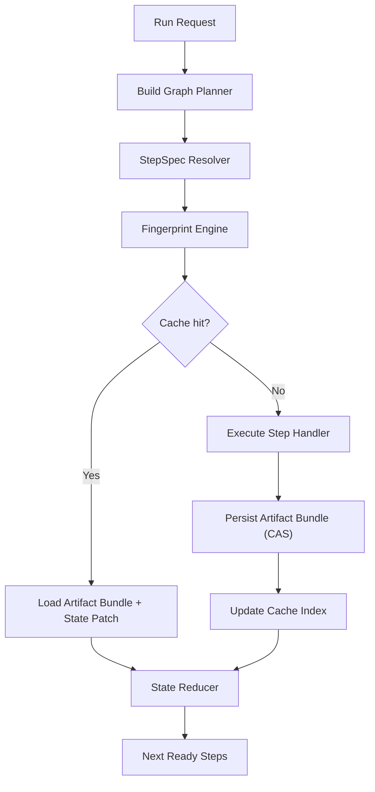

# Blueprint 03: Deterministic Build Graph and Incremental Cache

## 1. Executive Summary
This blueprint takes a step identifier, prompt version, normalized `PipelineState` slice, and input file hashes, computes a deterministic SHA-256 fingerprint before step execution, and either restores cached state patches and artifacts or executes the step and stores the new result in SQLite.

Without step caching, refining a product concept or recovering from a mid-run error re-executes unchanged upstream stages. Many pipeline nodes are deterministic functions of stable inputs: prompt templates, platform manifests, specification documents, and upstream file hashes.

Evaluating nodes as a dependency graph with Content-Addressed Storage (CAS) skips redundant model calls on cache hits while invalidating downstream dependents whenever inputs or prompt versions change. Workers in the event-driven runtime check the cache index first, emit cache-hit telemetry, and invoke models only on cache misses.

## 2. Outcomes
1. 30-60% lower repeated-run latency during iterative refinements and retries.
2. 25-50% lower model token spend across runs that share unchanged upstream inputs.
3. Reproducible step outputs tied to explicit SHA-256 input fingerprints.
4. Inspectable node dependency lineage (`gemforge build status <run_id>`) for debugging and taint invalidation.

## 3. Target Architecture


## 4. Determinism Model
Each step fingerprint combines five deterministic inputs:
1. `step_id`
2. `step_version` (incremented when node code or prompt logic changes)
3. Normalized input `PipelineState` slice
4. Sorted SHA-256 hashes of input artifacts
5. Runtime contract (model identifier and template manifest version)

Fingerprint formula:
```text
SHA256(
  step_id + "|" +
  step_version + "|" +
  canonical_json(input_slice) + "|" +
  sorted(input_artifact_hashes) + "|" +
  runtime_contract
)
```

## 5. Cache Data Model
```sql
CREATE TABLE IF NOT EXISTS cache_entries (
  fingerprint TEXT PRIMARY KEY,
  step_id TEXT NOT NULL,
  step_version TEXT NOT NULL,
  state_patch_json TEXT NOT NULL,
  artifact_bundle_id TEXT NOT NULL,
  created_at TEXT NOT NULL,
  hit_count INTEGER NOT NULL DEFAULT 0
);

CREATE TABLE IF NOT EXISTS artifact_bundles (
  bundle_id TEXT PRIMARY KEY,
  manifest_json TEXT NOT NULL,
  created_at TEXT NOT NULL
);

CREATE TABLE IF NOT EXISTS artifact_objects (
  object_hash TEXT PRIMARY KEY,
  content BLOB NOT NULL,
  content_type TEXT NOT NULL,
  created_at TEXT NOT NULL
);
```

## 6. Build Graph Specification
### 6.1 StepSpec Contract
```python
from dataclasses import dataclass
from typing import Callable

@dataclass(frozen=True)
class StepSpec:
    step_id: str
    version: str
    depends_on: tuple[str, ...]
    input_selector: Callable[[dict], dict]
    artifact_selector: Callable[[dict], list[str]]
    executor: Callable[[dict], dict]
```

### 6.2 High-Return Cache Candidates
Priority stages with high return on investment (ROI) for caching:
1. `vision_polisher`
2. `ruthless_interrogator`
3. `architecture`
4. `platform_decision`
5. `qa_generator`

These stages perform multi-thousand-token model calls and frequently receive identical upstream inputs during downstream retries.

## 7. Invalidation Rules
1. Node implementation changes -> bump `StepSpec.version`.
2. Prompt file changes -> include prompt SHA-256 digest in the runtime contract.
3. Template manifest changes -> include `GemForgeTemplate.json` hash.
4. Model identifier changes -> include model name in the runtime contract.
5. Operator feedback or manual `gemforge build taint` -> marks the target node and its downstream dependents stale in `memory/taint_registry.db`.

## 8. Implementation Plan (Incremental)
### Phase 0: Fingerprint and Metrics Only
1. Compute and log step fingerprints without serving cached outputs.
2. Measure candidate hit rates across refinement runs.

### Phase 1: Read-Through Cache
1. Query [`core/build/cache.py`](../../core/build/cache.py) before executing cacheable nodes.
2. Restore cached `state_patch` dictionaries and files on cache hits.
3. Execute the node and store the resulting entry on cache misses.

### Phase 2: Dependency-Aware Incremental Rebuild
1. Declare explicit upstream dependencies for every pipeline node in [`core/build/graph.py`](../../core/build/graph.py).
2. Recompute only tainted nodes and their downstream dependents via [`core/build/taint_manager.py`](../../core/build/taint_manager.py).
3. Support partial resume from mid-pipeline stages while reusing valid upstream outputs.

### Phase 3: Content-Addressed Artifact Store
1. Store generated files in CAS tables keyed by SHA-256 content digest.
2. Reference object digests from bundle manifests to deduplicate unchanged files.
3. Diff bundle manifests across runs during audits.

## 9. File-Level Modules
1. [`core/build/graph.py`](../../core/build/graph.py)
2. [`core/build/hasher.py`](../../core/build/hasher.py)
3. [`core/build/cache.py`](../../core/build/cache.py)
4. [`core/build/taint_manager.py`](../../core/build/taint_manager.py)
5. [`pipeline.py`](../../pipeline.py)
6. [`src/gemforge/cli.py`](../../src/gemforge/cli.py)
7. [`tests/test_blueprint_03_build.py`](../../tests/test_blueprint_03_build.py)
8. [`tests/test_dependency_integrity.py`](../../tests/test_dependency_integrity.py)

## 10. Reference Boilerplate
```python
# core/build/hasher.py
import hashlib
import json

def canonical_json(value: dict) -> str:
    return json.dumps(value, sort_keys=True, separators=(",", ":"))

def step_fingerprint(
    step_id: str,
    step_version: str,
    input_slice: dict,
    artifact_hashes: list[str],
    runtime_contract: str,
) -> str:
    payload = "|".join(
        [
            step_id,
            step_version,
            canonical_json(input_slice),
            ",".join(sorted(artifact_hashes)),
            runtime_contract,
        ]
    )
    return hashlib.sha256(payload.encode("utf-8")).hexdigest()
```

```python
# core/build/cache.py
def execute_with_cache(step_spec, state, cache_store, runtime_contract):
    input_slice = step_spec.input_selector(state)
    artifact_hashes = step_spec.artifact_selector(state)
    fp = step_fingerprint(
        step_spec.step_id,
        step_spec.version,
        input_slice,
        artifact_hashes,
        runtime_contract,
    )
    hit = cache_store.get(fp)
    if hit:
        return {"from_cache": True, "state_patch": hit["state_patch"], "artifacts": hit["artifacts"]}

    result = step_spec.executor(state)
    cache_store.put(fp, result["state_patch"], result.get("artifacts", []))
    return {"from_cache": False, **result}
```

## 11. Dependencies
Phase 1 and Phase 2 require Python standard library `sqlite3` and `hashlib` only. Optional serialization speedup:
```toml
dependencies = [
  "orjson>=3.10.0"
]
```

## 12. Feature Flags
1. `GEMFORGE_BUILDGRAPH_CACHE_ENABLED=true|false`
2. `GEMFORGE_CACHE_STEPS=vision_polisher,ruthless_interrogator,architecture`
3. `GEMFORGE_CACHE_READONLY=true|false`

## 13. Testing and Validation
1. Unit: canonical JSON hashing stays invariant across dictionary key ordering.
2. Unit: bumping `step_version` invalidates prior cache entries.
3. Integration: repeated identical inputs produce cache hits on targeted steps.
4. Integration: tainting an upstream node invalidates all downstream dependents in `DEPENDENCY_MAP`.
5. Safety: corrupted cache payloads fall back cleanly to live node execution.

## 14. Risk Register
1. Stale cache hits caused by omitted input fields.
   Mitigation: explicit per-node input selectors verified in shadow mode.
2. Unbounded SQLite cache growth.
   Mitigation: time to live (TTL) expiration plus least recently used (LRU) pruning on `cache_entries`.
3. Nondeterministic timestamps or random identifiers leaking into fingerprints.
   Mitigation: exclude wall-clock fields from fingerprint selectors.

## 15. Success Criteria
1. At least 40% cache hit rate during iterative `gemforge resume refine` workflows.
2. At least 30% lower median runtime on refinement cycles.
3. At least 25% lower token cost without test regressions.
4. Identical restored artifacts on deterministic replay of cached steps.
