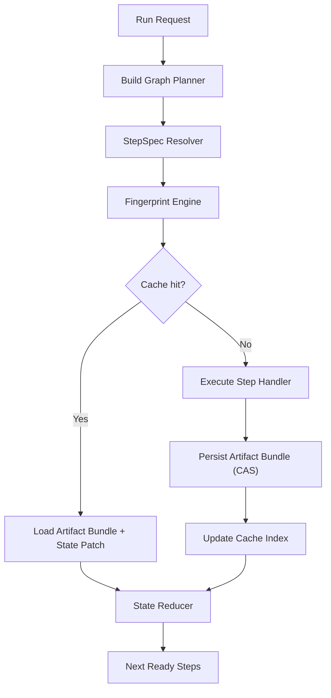

# Blueprint 03: Deterministic Build Graph + Incremental Cache

## 1. Executive Summary
GemForge reruns most of the pipeline when refining a vision or recovering from a mid-run failure. This creates avoidable cost and latency because many steps are pure functions of stable inputs (prompts, selected template, canonical docs, prior artifacts). This blueprint introduces deterministic step fingerprints and content-addressed caching so unchanged work is reused automatically.

The architectural shift is from "execute nodes in fixed sequence" to "evaluate a deterministic build graph where each node has explicit inputs and reproducible outputs." Cache hits short-circuit redundant LLM calls and artifact regeneration while preserving correctness through strict invalidation and versioned step contracts.

This pairs naturally with the event-driven runtime: workers consult cache before execution, publish cache-hit events, and only perform real work on misses.

## 2. Outcomes
1. 30-60% reduction in repeated-run latency for refinements and retries.
2. 25-50% reduction in LLM spend for near-identical runs.
3. Reproducible artifacts tied to explicit input hashes.
4. Clear dependency lineage for debugging and audits.

## 3. Target Architecture


## 4. Determinism Model
Each step fingerprint is derived from:
1. `step_id`
2. `step_version` (bump on logic/prompt change)
3. Normalized input state slice
4. Input artifact hashes
5. Relevant environment contract (model name, template version)

Fingerprint formula:
```text
SHA256(
  step_id + "|" +
  step_version + "|" +
  canonical_json(input_slice) + "|" +
  sorted(input_artifact_hashes) + "|" +
  runtime_contract
)
```

## 5. Cache Data Model
```sql
CREATE TABLE IF NOT EXISTS cache_entries (
  fingerprint TEXT PRIMARY KEY,
  step_id TEXT NOT NULL,
  step_version TEXT NOT NULL,
  state_patch_json TEXT NOT NULL,
  artifact_bundle_id TEXT NOT NULL,
  created_at TEXT NOT NULL,
  hit_count INTEGER NOT NULL DEFAULT 0
);

CREATE TABLE IF NOT EXISTS artifact_bundles (
  bundle_id TEXT PRIMARY KEY,
  manifest_json TEXT NOT NULL,
  created_at TEXT NOT NULL
);

CREATE TABLE IF NOT EXISTS artifact_objects (
  object_hash TEXT PRIMARY KEY,
  content BLOB NOT NULL,
  content_type TEXT NOT NULL,
  created_at TEXT NOT NULL
);
```

## 6. Build Graph Specification
### 6.1 StepSpec Contract
```python
from dataclasses import dataclass
from typing import Callable

@dataclass(frozen=True)
class StepSpec:
    step_id: str
    version: str
    depends_on: tuple[str, ...]
    input_selector: Callable[[dict], dict]
    artifact_selector: Callable[[dict], list[str]]
    executor: Callable[[dict], dict]
```

### 6.2 First High-ROI Cache Candidates
1. `vision_polisher`
2. `ruthless_interrogator`
3. `architecture`
4. `platform_decision`
5. `qa_generator`

These are expensive and frequently re-run with identical inputs.

## 7. Invalidation Rules
1. Step logic changed -> bump `StepSpec.version`.
2. Prompt changed -> include prompt hash in runtime contract.
3. Template metadata changed -> include template manifest hash.
4. Model changed -> include model identifier.
5. User feedback changed -> affects selected input slices and invalidates dependent nodes.

## 8. Implementation Plan (Incremental)
### Phase 0: Fingerprint and Metrics Only
1. Compute and log fingerprints for key nodes without caching.
2. Record potential hit rates to prioritize rollout.

### Phase 1: Read-Through Cache
1. Add cache lookup before selected node execution.
2. On hit, apply cached `state_patch` and artifacts.
3. On miss, execute node and write cache entry.

### Phase 2: Dependency-Aware Incremental Rebuild
1. Build explicit dependency map for all nodes.
2. Recompute only descendants of changed nodes.
3. Support partial resume from arbitrary step with cache reuse.

### Phase 3: Content-Addressed Artifact Store
1. Store artifacts as CAS objects with deduplication.
2. Bundle manifests reference object hashes.
3. Enable artifact diffing between runs for auditability.

## 9. File-Level Changes
1. New: `core/buildgraph/spec.py`
2. New: `core/buildgraph/fingerprint.py`
3. New: `core/buildgraph/cache_store.py`
4. New: `core/buildgraph/executor.py`
5. Update: `pipeline.py` (wrap node execution with buildgraph executor)
6. Update: `core/llm.py` (expose stable runtime contract details)
7. New: `tests/test_step_fingerprint.py`
8. New: `tests/test_incremental_rebuild.py`

## 10. Reference Boilerplate
```python
# core/buildgraph/fingerprint.py
import hashlib
import json

def canonical_json(value: dict) -> str:
    return json.dumps(value, sort_keys=True, separators=(",", ":"))

def step_fingerprint(
    step_id: str,
    step_version: str,
    input_slice: dict,
    artifact_hashes: list[str],
    runtime_contract: str,
) -> str:
    payload = "|".join(
        [
            step_id,
            step_version,
            canonical_json(input_slice),
            ",".join(sorted(artifact_hashes)),
            runtime_contract,
        ]
    )
    return hashlib.sha256(payload.encode("utf-8")).hexdigest()
```

```python
# core/buildgraph/executor.py
def execute_with_cache(step_spec, state, cache_store, runtime_contract):
    input_slice = step_spec.input_selector(state)
    artifact_hashes = step_spec.artifact_selector(state)
    fp = step_fingerprint(
        step_spec.step_id,
        step_spec.version,
        input_slice,
        artifact_hashes,
        runtime_contract,
    )
    hit = cache_store.get(fp)
    if hit:
        return {"from_cache": True, "state_patch": hit["state_patch"], "artifacts": hit["artifacts"]}

    result = step_spec.executor(state)
    cache_store.put(fp, result["state_patch"], result.get("artifacts", []))
    return {"from_cache": False, **result}
```

## 11. Dependency Additions
No external dependency is required for phase 1 (SQLite + stdlib only). Optional phase 3 optimization:
```toml
dependencies = [
  # existing...
  "orjson>=3.10.0"
]
```

## 12. Feature Flags
1. `GEMFORGE_BUILDGRAPH_CACHE_ENABLED=true|false`
2. `GEMFORGE_CACHE_STEPS=vision_polisher,ruthless_interrogator,architecture`
3. `GEMFORGE_CACHE_READONLY=true|false` (safe dry run mode)

## 13. Testing and Validation
1. Unit: canonical hashing is stable across dict key order.
2. Unit: version bump invalidates cache.
3. Integration: repeated identical run yields cache hits for targeted steps.
4. Integration: changed feedback invalidates only dependent steps.
5. Safety: cache corruption fallback to live execution.

## 14. Risk Register
1. False cache hits from incomplete input selection.
   Mitigation: strict input selectors + shadow-mode verification.
2. Cache bloat.
   Mitigation: TTL plus LRU pruning on `cache_entries`.
3. Hidden nondeterminism from wall-clock or random content.
   Mitigation: disallow nondeterministic fields in fingerprint input; enforce seeded generation where needed.

## 15. Success Criteria
1. >=40% cache hit rate on iterative refinement workflows.
2. >=30% median runtime reduction for `resume refine` cycles.
3. >=25% LLM cost reduction without output regressions.
4. Deterministic replay of cached steps with identical artifacts.
